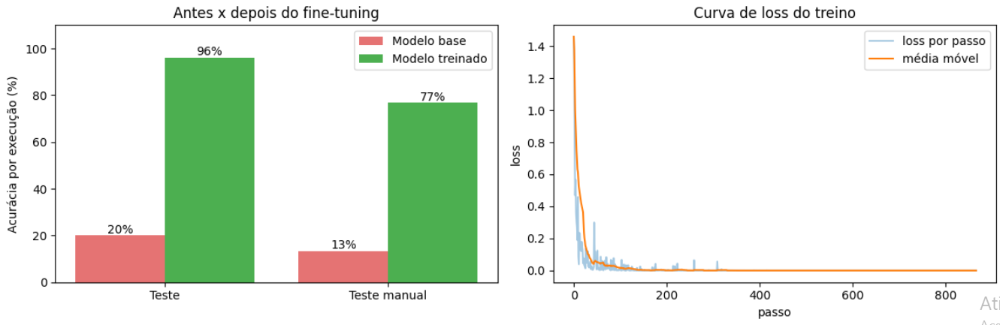
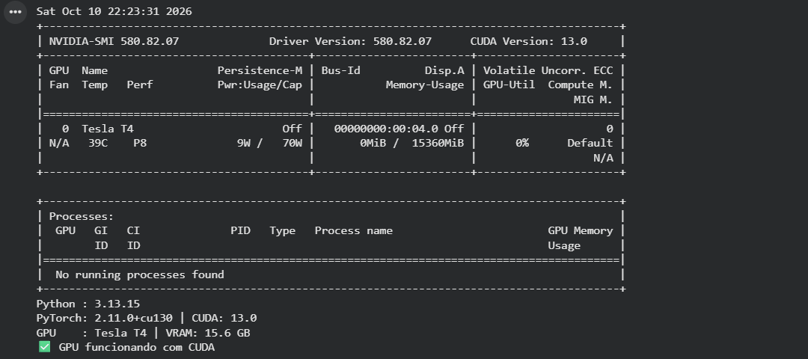
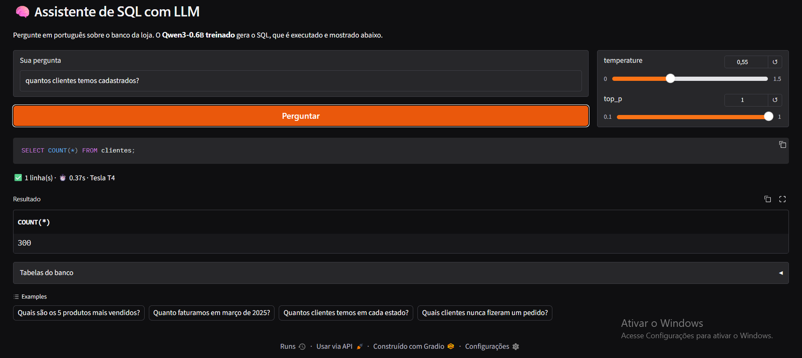

# Checkpoint de IA: Assistente Texto → SQL com Qwen3-0.6B

**Grupo:** Breno Silva(rm99275) · Eduardo Araujo(rm99758) · Gabriela Trevisan(rm99500) · Gustavo Akio(rm550241) · Rafael Franck(rm550875)

## O problema
Quem não sabe SQL não consegue tirar informações de um banco de dados sozinho. Treinamos uma LLM pequena para **transformar perguntas em português em consultas SQL** sobre o banco fixo de uma loja online. A consulta é **executada** e o resultado volta para o usuário. O tema é o "Texto → SQL em um schema fixo", da lista de sugestões.

```
Pergunta:  "Quais são os 3 produtos mais vendidos?"
SQL:       SELECT p.nome, SUM(i.quantidade) AS unidades FROM itens_pedido i
           JOIN pedidos pe ON i.pedido_id = pe.id JOIN produtos p ON i.produto_id = p.id
           WHERE pe.status <> 'cancelado' GROUP BY p.id ORDER BY unidades DESC LIMIT 3;
Resultado: tabela com os 3 produtos e as unidades vendidas
```

## A LLM escolhida: Qwen3-0.6B
- **Está na lista** de modelos sugeridos pelo professor.
- **Tamanho:** tem 0,6 bilhão de parâmetros. Com LoRA, o treino cabe com folga na GPU T4 gratuita do Google Colab. Treinar todos os pesos estourou a memória da T4 (15 GB), por isso usamos LoRA.
- **Conhecimento prévio:** já viu bastante código, inclusive SQL, então aprende rápido o padrão do nosso banco.

## Como foi feito
Tudo está em **um único notebook**, [`checkpoint_ia_texto_sql.ipynb`](checkpoint_ia_texto_sql.ipynb), no mesmo formato da Aula 8:

| Etapa | O que faz |
|---|---|
| 1 | Verifica a GPU (`nvidia-smi`) |
| 3 | Prompt padronizado (`### Banco / ### Pergunta / ### SQL`) e funções `carregar` e `gerar` |
| 4 | Cria o banco SQLite da loja e executa as consultas em modo somente leitura |
| 5 | Monta o dataset de treino, validação, teste e teste manual |
| 6–7 | Avalia o modelo base, **antes** do treino |
| 8 | Fine-tuning com **LoRA** na GPU (forward → loss → backward → step), com validação a cada época |
| 9 | Avalia **depois** do treino e compara |
| 10 | Testa parâmetros de geração (temperature, top_p) e de treino (taxa de aprendizado, épocas, rank do LoRA) |
| 11 | Mostra onde o modelo erra |
| 13 | Frontend web (Gradio) para o usuário fazer perguntas |

**Banco:** 5 tabelas, com 300 clientes, 8 categorias, 56 produtos, 2.000 pedidos e cerca de 5.000 itens. Existe uma regra de negócio que **não está no prompt** e o modelo precisa aprender com os exemplos: *faturamento e vendas não contam pedidos cancelados*.

**Dataset:**
- São 26 tipos de pergunta, cada um com 4 formas de perguntar.
- O **treino** (1.155 exemplos) usa 3 dessas formas.
- **Validação e teste** usam a 4ª forma, que o modelo nunca viu no treino.
- O **teste manual** tem 30 perguntas escritas à mão, de jeitos bem diferentes.

**Avaliação:** o SQL gerado é **executado** e o resultado é comparado com o da consulta correta. Uma consulta escrita de outro jeito, mas que devolve o mesmo resultado, conta como acerto. Também medimos a % de SQL válido e o tempo por pergunta.

## Resultados

### Antes x depois do fine-tuning
| Modelo | Teste (75 perguntas) | Teste manual (30 perguntas) |
|---|---|---|
| Qwen3-0.6B base (antes) | 20,0% (15/75) | 13,3% (4/30) |
| Qwen3-0.6B + LoRA (depois) | **96,0% (72/75)** | **76,7% (23/30)** |
| **Ganho** | **+76 pontos** | **+63 pontos** |



### Análise
- **O fine-tuning funcionou.** No teste, o modelo passou de 1 acerto em cada 5 perguntas para 72 de 75. Treinamos só cerca de 1% dos parâmetros (LoRA), em poucos minutos, numa GPU gratuita.
- **O modelo aprendeu a regra de negócio.** A regra "faturamento não conta pedidos cancelados" não está no prompt. O modelo base não tinha como saber dela. O modelo treinado passou a gerar `WHERE pe.status <> 'cancelado'` sozinho, como mostra o print do frontend.
- **Generalização:** o teste usa uma forma de perguntar que o modelo nunca viu no treino, e mesmo assim ele acertou 96%. O teste manual tem perguntas escritas de jeitos bem diferentes ("Existe algum produto encalhado?", "Qual UF trouxe mais dinheiro?") e ficou em 77%. A diferença entre os dois mostra o limite do treino com templates: quanto mais a pergunta foge do padrão, mais o modelo erra.
- **Curva de loss:** a loss cai de cerca de 1,4 para perto de 0 nos primeiros ~150 passos e fica estável até o fim, cerca de 870 passos em 3 épocas. O modelo aprendeu rápido o padrão dos exemplos de treino. Como a loss praticamente zera, as épocas finais trazem pouco ganho, e o modelo fica muito ajustado aos templates do treino (*overfitting* leve). Isso ajuda a explicar a diferença entre o teste (96%) e o teste manual (77%). Por isso, a cada época o notebook avalia na validação e guarda o melhor checkpoint.
- **Onde ainda erra:** a maior parte dos erros está no teste manual (7 de 30, contra 3 de 75 no teste). São perguntas escritas de jeitos bem diferentes dos exemplos de treino, como perguntas informais, sem o ano ou com o nome do estado por extenso em vez da sigla. A Etapa 11 do notebook mostra cada erro, com o SQL gerado ao lado do SQL correto, e a acurácia por tipo de pergunta.

### Testes de parâmetros
Os resultados completos estão na **Etapa 10** do notebook.

**Geração (Etapa 10.1):** o modelo treinado foi avaliado no teste com 4 combinações:

| temperature | top_p |
|---|---|
| 0.0 (determinístico) | 1.0 |
| 0.3 | 0.9 |
| 0.7 | 0.9 |
| 1.0 | 0.95 |

Com `temperature = 0` o modelo sempre escolhe o token mais provável, que é o comportamento esperado para gerar SQL. Valores maiores sorteiam tokens menos prováveis, o que aumenta a chance de gerar SQL inválido.

**Treino (Etapa 10.2):** além do treino principal, treinamos o modelo base de novo com outras duas configurações e comparamos a acurácia final:

| Configuração | Taxa de aprendizado | Épocas | Rank do LoRA |
|---|---|---|---|
| Principal | 2e-4 | 3 | 16 |
| `lr5e-5_r16_1ep` | 5e-5 | 1 | 16 |
| `lr2e-4_r4_2ep` | 2e-4 | 2 | 4 |

### Limitações e próximos passos
- O banco e as perguntas são de um único domínio (loja online), e o treino usa 26 tipos de pergunta.
- Para melhorar o teste manual: escrever mais variações de perguntas para o treino, usar um modelo maior da lista (Qwen3-1.7B) ou usar um dataset público como o Spider.

## GPU e frontend
Nenhum integrante tinha placa NVIDIA disponível, e o CUDA só funciona em placas NVIDIA. Por isso, todo o projeto rodou na **GPU NVIDIA Tesla T4 do Google Colab**, o mesmo ambiente usado na Aula 8. O print mostra a GPU reconhecida pelo PyTorch com CUDA.




## Como rodar
1. Abra o notebook no Google Colab.
2. Vá em **Ambiente de execução → Alterar o tipo → GPU T4**.
3. Rode as células de cima para baixo. O treino leva cerca de 10 a 20 minutos.

## Referências
- Qwen Team. *Qwen3 Technical Report*. 2025.
- Allal, L. B. et al. *SmolLM2: When Smol Goes Big*. 2025 (base da Aula 8).
- Yu, T. et al. *Spider: A Large-Scale Human-Labeled Dataset for Text-to-SQL*. 2018.
- Hu, E. et al. *LoRA: Low-Rank Adaptation of Large Language Models*. 2021.
- Hugging Face Transformers e PEFT: documentação oficial.
